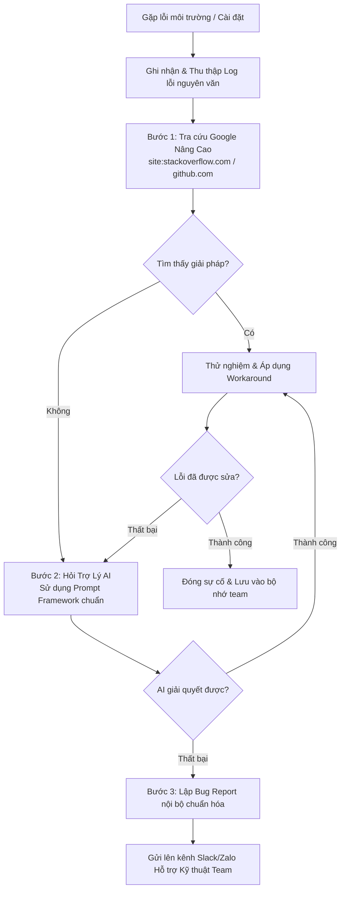

# 🛡️ Báo Cáo Phân Tích: Chuẩn Hóa Quy Trình Hỗ Trợ Kỹ Thuật Nội Bộ

---

## 📌 Thông Tin Bài Nộp
* **Họ và tên - MSSV:** Lê Hồ Thanh Thảo - N26DTCN030
* **Môn học:** IT108-K26 - Nhập Môn CNTT
* **Bài tập:** Session 21 - Exercise 05 (Bài 5)

---

## 1. Sơ Đồ Luồng Xử Lý Lỗi (Troubleshooting Flowchart)

## 2. Kịch Bản Gỡ Lỗi Thần Tốc (Tích hợp Google & AI)
- chỉ với 1 cú pháp với GG
site:stackoverflow.com OR site:github.com "[Nhập_Nội_Dung_Lỗi_Nguyên_Văn]" [Tên_Công_Cụ] -quangcao -ad
- prompt AI 

[BỐI CẢNH MÔI TRƯỜNG]
Tôi là lập trình viên trong team, đang làm việc trên hệ điều hành [Windows 11 / macOS] với công cụ [Node.js / Git / VS Code].

[HÀNH VI MONG MUỐN]
Thực hiện thao tác: [Mô tả ngắn gọn thao tác mong muốn].

[HÀNH VI THỰC TẾ & LOG LỖI]
Hệ thống trả về thông báo lỗi nguyên văn:[Dán toàn bộ Log lỗi / Mã lỗi nguyên văn tại đây]

*[YÊU CẦU]*
*1. Giải thích nguyên nhân gây ra lỗi trong 2 câu ngắn gọn.
2. Đưa ra hướng dẫn khắc phục từng bước (step-by-step) kèm các dòng lệnh Terminal chính xác.*

